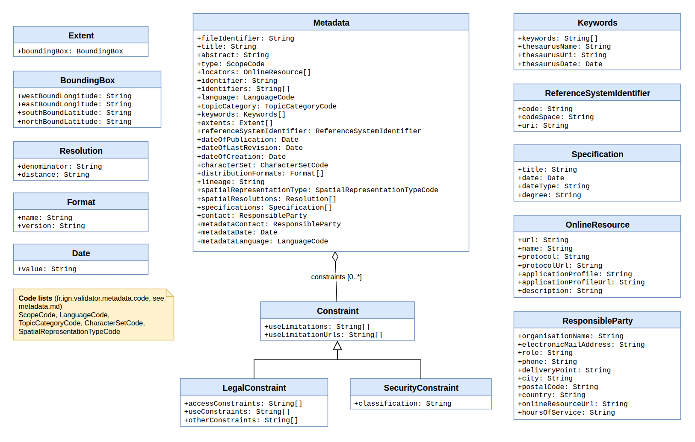

# Metadata

The following Metadata model is dedicated to validation according to INSPIRE and CNIG profiles. XML parsing (ISO 19115) is partial and based on XPath.

## Class diagram

## Metadata properties

Multiplicity according to INSPIRE for datasets (INSPIRE_GUIDELINE_2017). `IDI` stands for `identificationInfo[1]/*` in the XPath.

| property | type | title | multiplicity | XPath |
| -------- | ---- | ----- | ------------ | ----- |
| fileIdentifier | `String` | File identifier | [0..1] | `fileIdentifier` |
| title | `String` | Resource title | [1] | `IDI/citation/*/title` |
| abstract | `String` | Resource abstract | [1] | `IDI/abstract` |
| type | `ScopeCode` | Resource type | [1] | `hierarchyLevel` |
| locators | `OnlineResource[]` | Resource locator | [1..*] | `distributionInfo/*/transferOptions/*/onLine/*/linkage` |
| identifiers | `String[]` | Unique resource identifier | [1..*] | `IDI/citation/*/identifier/*/code` |
| language | `LanguageCode` | Resource language | [0..*] (1) | `IDI/language` |
| topicCategory | `TopicCategoryCode` | Topic category | [1..*] (1) | `IDI/topicCategory` |
| keywords | `Keywords[]` | Keyword | [1..*] | `IDI/descriptiveKeywords/*/keyword` `IDI/descriptiveKeywords/*/thesaurusName/*/title` |
| extents | `Extent[]` | Extents with geographic bounding box | [1..*] | `IDI/extent/*/geographicElement/*/westBoundLongitude` `IDI/extent/*/geographicElement/*/eastBoundLongitude` `IDI/extent/*/geographicElement/*/southBoundLatitude` `IDI/extent/*/geographicElement/*/northBoundLatitude` |
| referenceSystemIdentifier | `ReferenceSystemIdentifier` | Coordinate Reference System | [0..*] (1) | `referenceSystemInfo/*/referenceSystemIdentifier/*/code` |
| dateOfPublication | `Date` | Date of publication | [0..*] (2) | `IDI/citation/*/date[./*/dateType/*/text()='publication']/*/date` |
| dateOfLastRevision | `Date` | Date of last revision | [0..1] (2) | `IDI/citation/*/date[./*/dateType/*/text()='revision']/*/date` |
| dateOfCreation | `Date` | Date of creation | [0..1] (2) | `IDI/citation/*/date[./*/dateType/*/text()='creation']/*/date` |
| characterSet | `CharacterSetCode` | Character Encoding | [1..*] (1) | `IDI/characterSet` |
| constraints | `Constraint[]` | Resource constraints ([details](metadata/resourceConstraints.md)) | [0..*] | `IDI/resourceConstraints/*` |
| distributionFormats | `Format[]` | Encoding | [0..*] | `distributionInfo/*/distributionFormat/*/name` `distributionInfo/*/distributionFormat/*/version` |
| spatialRepresentationType | `SpatialRepresentationTypeCode` | Spatial representation type | [1..*] (1) | `IDI/spatialRepresentationType` |
| lineage | `String` | Lineage | [1] | `dataQualityInfo/*/lineage/*/statement` |
| spatialResolutions | `Resolution[]` | Spatial resolution | [0..*] | `IDI/spatialResolution/*/equivalentScale/*/denominator` `IDI/spatialResolution/*/distance` |
| specifications | `Specification[]` | Specification title and degree | [1..*] | `dataQualityInfo/*/report/*/result/*/specification` `dataQualityInfo/*/report/*/result/*/pass` |
| contact | `ResponsibleParty` | Responsible party | [0..*] (1) | `IDI/pointOfContact/*/organisationName` `IDI/pointOfContact/*/address/*/electronicMailAddress` `IDI/pointOfContact/*/role` |
| metadataContact | `ResponsibleParty` | Metadata point of contact | [1..*] (1) | `contact/*/organisationName` `contact/*/address/*/electronicMailAddress` `contact/*/role` |
| metadataDate | `Date` | Metadata date | [1] | `dateStamp` |
| metadataLanguage | `LanguageCode` | Metadata language | [1] | `language` |

> (1) multiplicity is adapted, only the first element is parsed
>
> (2) the most recent date of the given type is kept

Remarks :

* `type` : ex : `dataset`.
* `spatialResolutions` : equivalent scale (`denominator`) or `distance`.
* `specifications` : the `degree` is read from `pass`.

## References

Sections and pages of the documents listed in [Resources](#resources) describing each property.

| property | references |
| -------- | ---------- |
| fileIdentifier | INSPIRE_GUIDELINE_2017 - 2.2 General requirements / 2.2.1 File identifier (p11) CNIG_MD_DU - 1) Identification des données / fileIdentifier (p5) |
| title | INSPIRE_GUIDELINE_2017 - 2.3 Identification info section / 2.3.1 Resource title (p14) INSPIRE_GUIDELINE_2013 - 2.2 Identification / 2.2.1 Resource title (p17) CNIG_MD_DU - 1) Identification des données / Intitulé de la resource (p4) |
| abstract | INSPIRE_GUIDELINE_2017 - 2.3 Identification info section / 2.3.2 Resource abstract (p15) INSPIRE_GUIDELINE_2013 - 2.2 Identification / 2.2.2 Resource abstract (p18) CNIG_MD_DU - 1) Identification des données / Résumé de la resource (p4) |
| type | INSPIRE_GUIDELINE_2017 - 3.1.1.1 Resource type (p33) INSPIRE_GUIDELINE_2013 - 2.2 Identification / 2.2.3 Resource Type (p20) CNIG_MD_DU - 1) Identification des données / Type de la resource (p5) |
| locators | INSPIRE_GUIDELINE_2017 - 3.1.3.1 Resource locator for data set or series (p42) INSPIRE_GUIDELINE_2013 - 2.2 Identification / 2.2.4 Resource locator (p21) CNIG_MD_DU - 1) Identification des données / Localisateur de la ressource (p5) |
| identifiers | INSPIRE_GUIDELINE_2017 - 3.1.2.1 Unique resource identifier (p34) INSPIRE_GUIDELINE_2013 - 2.2 Identification / 2.2.5 Unique resource identifier (p24) CNIG_MD_DU - 1) Identification des données / Identificateur de ressource unique (p5) |
| language | INSPIRE_GUIDELINE_2017 - 3.1.2.4 Resource language (p40) INSPIRE_GUIDELINE_2013 - 2.2 Identification / 2.2.7 Resource langage (p26) CNIG_MD_DU - 1) Identification des données / Langue de la ressource (p6) |
| topicCategory | INSPIRE_GUIDELINE_2013 - 2.3 Classification of spatial data and services / 2.3.1 Topic category (p27) CNIG_MD_DU - 2) Classification des données et services géographiques / Catégorie thématique (p7) |
| keywords | INSPIRE_GUIDELINE_2017 - 2.3.5 Using keywords (p20) INSPIRE_GUIDELINE_2013 - 2.3 Classification of spatial data and services / 2.4 Keyword (p31) CNIG_MD_DU - 3) Mots-clés (p8) |
| extents | INSPIRE_GUIDELINE_2017 - 2.3.8 Geographic bounding box (p27-28) INSPIRE_GUIDELINE_2013 - 2.5 Geographic location / 2.5.1 Geographic bounding box (p35) CNIG_MD_DU - 4) Situation géographique / Rectangle de délimitation géographique (p9) |
| referenceSystemIdentifier | INSPIRE_GUIDELINE_2017 - 3.2.1.1 Coordinates reference systems (p48) CNIG_MD_DU - 4) Situation géographique / Référentiel de coordonnées (p9) |
| dateOfPublication | INSPIRE_GUIDELINE_2017 - 2.3.4 Temporal references (p17) INSPIRE_GUIDELINE_2013 - 2.6 Temporal reference / 2.6.2 Date of publication (p38) |
| dateOfLastRevision | INSPIRE_GUIDELINE_2017 - 2.3.4 Temporal references (p17) INSPIRE_GUIDELINE_2013 - 2.6 Temporal reference / 2.6.3 Date of last revision (p40) CNIG_MD_DU - 5) Références temporelles / Dates de référence (p10) |
| dateOfCreation | INSPIRE_GUIDELINE_2017 - 2.3.4 Temporal references (p17) INSPIRE_GUIDELINE_2013 - 2.6 Temporal reference / 2.6.4 Date of creation (p38) |
| characterSet | CNIG_MD_DU - Encodage - (p6) |
| constraints | INSPIRE_GUIDELINE_2013 - 2.9 Constraints related to access and use (p51-55) |
| distributionFormats | CNIG_MD_DU - Encodage - (p6) |
| spatialRepresentationType | CNIG_MD_DU - Type de représentation géographique - (p7) |
| lineage | INSPIRE_GUIDELINE_2013 - 2.7 Quality and validity / 2.7.1 Lineage (p42) CNIG_MD_DU - 6) Qualité et validité / Généalogie (p10) |
| spatialResolutions | INSPIRE_GUIDELINE_2013 - 2.7 Quality and validity / 2.7.2 Spatial resolution (p45) CNIG_MD_DU - 6) Qualité et validité / Résolution spatiale (p10) |
| specifications | INSPIRE_GUIDELINE_2013 - 2.8 Conformity / 2.8.2 Specification (p49) CNIG_MD_DU - 7) Conformité / Spécification (p12) INSPIRE_GUIDELINE_2013 - 2.8 Conformity / 2.8.1 Degree (p48) CNIG_MD_DU - 7) Conformité / Degré (p12) |
| contact | INSPIRE_GUIDELINE_2017 - 2.3 Identification info section / 2.3.3 Responsible organisation and point of contact for the described resource (p16) INSPIRE_GUIDELINE_2013 - 2.10 Responsible organisation (p55) CNIG_MD_DU - 9) Organisation responsable de l’établissement, de la gestion, de la maintenance et de la diffusion des séries de données (p15) |
| metadataContact | INSPIRE_GUIDELINE_2013 - 2.11 Metadata on metadata / 2.11.1 Metadata point of contact (p55) CNIG_MD_DU - 10) Métadonnées concernant les métadonnées / Point de contact pour la métadonnées (p15) |
| metadataDate | INSPIRE_GUIDELINE_2013 - 2.11 Metadata on metadata / 2.11.2 Metadata date (p60) CNIG_MD_DU - 10) Métadonnées concernant les métadonnées / Date des métadonnées (p15) |
| metadataLanguage | INSPIRE_GUIDELINE_2013 - 2.11.3 Metadata language / 2.11.3 Metadata langage (p60) CNIG_MD_DU - 10) Métadonnées concernant les métadonnées / Langue des métadonnées (p15) |

## Resources

### Documents (english)

* INSPIRE_GUIDELINE_2017 : [Technical Guidance for the implementation of
INSPIRE dataset and service metadata based
on ISO/TS 19139:2007](https://inspire.ec.europa.eu/id/document/tg/metadata-iso19139)

https://inspire.ec.europa.eu/id/document/tg/metadata-iso19139

* INSPIRE_GUIDELINE_2013: [INSPIRE Metadata Implementing
Rules: Technical Guidelines based
on EN ISO 19115 and EN ISO 19119](https://inspire.ec.europa.eu/documents/inspire-metadata-implementing-rules-technical-guidelines-based-en-iso-19115-and-en-iso-1)

### Documents (french)

* CNIG_MD_INSPIRE - [Guide de saisie des éléments
de métadonnées INSPIRE - juillet 2014](http://inspire.ec.europa.eu/documents/Metadata/MD_IR_and_ISO_20131029.pdf)

* CNIG_MD_DU - [CNIG - Consignes de saisie des
Métadonnées INSPIRE pour les
documents d’urbanisme - septembre 2017](http://cnig.gouv.fr/wp-content/uploads/2017/09/170914_consignes_saisie_metadonnees_DU_vprojet.pdf)

* CNIG_MD_SUP - [CNIG - Consignes de saisie des
Métadonnées INSPIRE pour les
servitudes d’utilité publique](http://cnig.gouv.fr/wp-content/uploads/2017/09/170914_consignes_saisie_metadonnees_SUP_vprojet.pdf)

### Normative references

* [ISO 19115-1:2014 - Geographic information -- Metadata -- Part 1: Fundamentals](https://www.iso.org/fr/standard/53798.html)
* [ISO/TS 19139:2007 - Geographic information -- Metadata -- XML schema implementation](https://www.iso.org/standard/32557.html)

### XSD schemas and resources

* [http://www.isotc211.org/2005/](http://www.isotc211.org/2005/)
* [http://www.isotc211.org/2005/resources/Codelist/gmxCodelists.xml](http://www.isotc211.org/2005/resources/Codelist/gmxCodelists.xml)

* [INSPIRE metadata code list register](http://inspire.ec.europa.eu/metadata-codelist/)
* [ISO 19115 and 19115-2 CodeList Dictionaries](https://geo-ide.noaa.gov/wiki/index.php?title=ISO_19115_and_19115-2_CodeList_Dictionaries)

### Third part tools

* [http://www.isotc211.org/2005/gmd - schema explorer](http://www.datypic.com/sc/niem21/ns-gmd.html)
* [INSPIRE metadata validator](http://inspire-geoportal.ec.europa.eu/validator2/)
